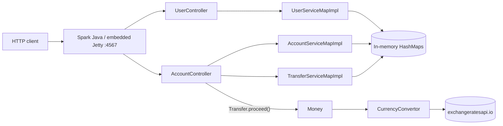

# Money Transfer API

A small, standalone REST service for transferring money between accounts, with multi-currency support. Written in Java 8 on [Spark Java](https://sparkjava.com/) (embedded Jetty) with an in-memory datastore — no application server, no Spring.

It was written as a solution to a take-home backend exercise (a REST API for money transfers, in-memory store, runnable as a standalone program, demonstrated with tests). This document describes what the code actually does, including its known limitations.

## Architecture



| Layer | Package | Notes |
|---|---|---|
| Entry point | `Main` | Registers routes and seeds demo data |
| Controllers | `controllers` | Spark route lambdas; JSON via Gson |
| Services | `service`, `service.impl` | Interfaces + singleton `HashMap`-backed implementations |
| Domain | `entity` | `User`, `Account`, `Transfer`, `Money`, response envelope |
| FX | `currency` | Fetches live rates over HTTP |

All responses are wrapped in a common envelope:

```json
{ "status": "SUCCESS", "message": "...", "data": { } }
```

`status` is `SUCCESS` or `ERROR`. Note that errors are signalled in the body; the HTTP status code is 200 in both cases.

## API

Base URL: `http://localhost:4567`

### Users
| Method | Path | Description |
|---|---|---|
| GET | `/users` | List users |
| GET | `/users/:id` | Get a user |
| GET | `/users/:id/accounts` | List a user's accounts |
| POST | `/users` | Create a user |
| PUT | `/users/:id` | Update a user (id taken from the body) |
| DELETE | `/users/:id` | Delete a user |
| OPTIONS | `/users/:id` | Check whether a user exists |

### Accounts and transfers
| Method | Path | Description |
|---|---|---|
| GET | `/accounts` | List accounts |
| GET | `/accounts/:accountNumber` | Get an account |
| POST | `/accounts` | Create an account |
| PUT | `/accounts/:accountNumber` | Update name / currency / funds (account number taken from the body) |
| DELETE | `/accounts/:accountNumber` | Delete an account |
| OPTIONS | `/accounts/:accountNumber` | Check whether an account exists |
| POST | `/accounts/:accountNumber/transfers` | Transfer from this account to another |
| GET | `/accounts/:accountNumber/transfers` | List the account's transfers |

### Examples

```bash
# Create a user (a default account is created for them)
curl -X POST localhost:4567/users \
  -d '{"firstName":"Jane","lastName":"Doe","email":"jane@example.com"}'

# List accounts to find account numbers (sequential, starting at 1000001)
curl localhost:4567/accounts

# Transfer 100 INR from account 1000001 to 1000002
curl -X POST localhost:4567/accounts/1000001/transfers \
  -d '{"accountNumberTo":"1000002","amount":"100","currency":"INR"}'
```

A successful transfer returns the `Transfer` with status `PROCEEDED`; insufficient funds returns `ERROR` with status `CANCELLED`. An unknown account, unsupported currency code, or non-numeric/negative amount returns an `ERROR` envelope.

## Data model

- **User**: `id` (sequential string), `firstName`, `lastName`, `email`, `accounts`. Constructing a user also creates a default zero-balance account.
- **Account**: `accountNumber` (sequential, from `1000001`), `name`, `currency`, `fundsAvailable: Money`, `transfers`.
- **Money**: `amount: double`, `currency: String`; rejects negative amounts. `add`/`sub`/comparisons convert the other operand into this currency first.
- **Transfer**: `id`, `accountFrom`, `accountTo`, `amount: Money`, `notes`, `createdAt`, `status` ∈ `CREATED, PENDING, RECEIVED, CANCELLED, PROCEEDED` (only `CREATED`, `CANCELLED` and `PROCEEDED` are used today).
- Supported currencies: the 33 ISO codes in `Money.Currencies` (e.g. EUR, GBP, INR, USD).

On startup `Main` seeds three users; the first has an INR savings account (1000) and an EUR account (500) in addition to defaults.

## Transfer flow and consistency

`POST /accounts/:id/transfers` validates the input, creates a `Transfer` (status `CREATED`) and calls `Transfer.proceed()`:

1. Convert the transfer amount into the source account's currency and compare with available funds.
2. If insufficient → `CANCELLED`, no balances change.
3. Otherwise debit the source and credit the destination (each converting into its own currency) → `PROCEEDED`.

**Concurrency, as implemented:** there is none beyond the single-threaded happy path. Storage is plain `HashMap`, singletons use unsynchronised lazy init, and the check-then-debit-then-credit sequence is not atomic or locked. Under concurrent requests (Spark serves requests on a Jetty thread pool) two transfers could both pass the funds check and overdraw an account, and a failure between debit and credit is not rolled back. The `transfersInSameTime` test runs two transfers sequentially, so it checks the insufficient-funds rule, not real concurrency.

**Idempotency:** not implemented. Retrying a `POST .../transfers` executes a second transfer.

**Money representation:** amounts are `double`, and FX rates are fetched live per operation, so results are subject to floating-point rounding and rate changes between check and apply.

## Build, run, test

Requires JDK 8 and Gradle 5.x (the build uses the legacy `compile` configuration, removed in Gradle 7).

```bash
gradle fatJar                                            # -> build/libs/money-transfer-all-1.0-SNAPSHOT.jar
java -jar build/libs/money-transfer-all-1.0-SNAPSHOT.jar
gradle test
```

Tests (`AccountTests`, `UserTests`, `TransferTests`) exercise the service layer directly (not over HTTP): CRUD, a successful transfer, insufficient funds, and a cross-currency transfer. Cross-currency paths call the external FX API, so they need network access and a working rates endpoint.

## Design trade-offs

- **Spark Java + Gson** over Spring/Dropwizard: tiny footprint, starts instantly, no container — matching the brief's "keep it simple" constraint.
- **In-memory maps behind service interfaces**: simple, and the `*Service` interfaces leave room to swap in a real store (an H2 properties file is present but unused).
- **Live FX conversion inside `Money`**: convenient, but couples domain arithmetic to a network call.

## Known issues

- `TransferController` (`GET /transfers/:id`) is defined but never registered in `Main`.
- Transfers are not appended to `Account.transfers`, so `GET /accounts/:id/transfers` returns an empty list.
- `https://api.exchangeratesapi.io` now requires an API key; unauthenticated calls fail and conversion falls back to a rate of 0.
- Build output (`bin/`, `build/`, `.gradle/`) and IDE files are committed.

## Future improvements

- Atomic transfers: per-account locks acquired in a consistent order (e.g. by account number) or a single-writer/ledger model; `ConcurrentHashMap` storage.
- Idempotency keys on `POST .../transfers` (store key → result, return the original result on retry).
- `BigDecimal` / `javax.money` amounts with explicit rounding; snapshot the FX rate on the transfer.
- Double-entry ledger instead of mutable balances; record transfers on both accounts.
- Proper HTTP status codes (400/404/409/422) and request validation.
- Register `TransferController`; HTTP-level and genuinely concurrent tests.
- Pluggable / cached FX provider with configuration for API keys; upgrade to a current Gradle and JDK.
