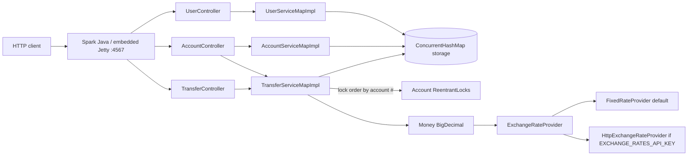

# Money Transfer API

A small, standalone REST service for transferring money between accounts, with multi-currency support. Written in **Java 17+** on [Spark Java](https://sparkjava.com/) (embedded Jetty) with an in-memory datastore — no application server, no Spring. Built and packaged with **Maven**.

It was written as a solution to a take-home backend exercise (a REST API for money transfers, in-memory store, runnable as a standalone program, demonstrated with tests). This document describes the current behaviour after the correctness and build modernisation work (see PR #2).

## Architecture



| Layer | Package | Notes |
|---|---|---|
| Entry point | `Main`, `App` | `Main` seeds demo data and starts `App`; `App` wires services and registers all controllers |
| Controllers | `controllers` | Spark route lambdas; JSON via Gson; proper HTTP status codes |
| Services | `service`, `service.impl` | Constructor-injected, `ConcurrentHashMap`-backed implementations |
| Domain | `entity` | `User`, `Account`, `Transfer`, immutable `Money` (`BigDecimal`), response envelope |
| FX | `currency` | Pluggable `ExchangeRateProvider` (`FixedRateProvider` offline default, or live HTTP with API key) |

All responses are wrapped in a common envelope:

```json
{ "status": "SUCCESS", "message": "...", "data": { } }
```

`status` is `SUCCESS` or `ERROR`. Errors also use matching HTTP status codes (400 / 404 / 409 / 422 / 500) via `ErrorHandlers`.

## API

Base URL: `http://localhost:4567` (override with the `PORT` environment variable).

### Users
| Method | Path | Description |
|---|---|---|
| GET | `/users` | List users |
| GET | `/users/:id` | Get a user |
| GET | `/users/:id/accounts` | List a user's accounts |
| POST | `/users` | Create a user (201; also opens a default zero-balance account) |
| POST | `/users/:id/accounts` | Open another account for the user (201) |
| PUT | `/users/:id` | Update a user |
| DELETE | `/users/:id` | Delete a user |
| OPTIONS | `/users/:id` | Check whether a user exists |

### Accounts and transfers
| Method | Path | Description |
|---|---|---|
| GET | `/accounts` | List accounts |
| GET | `/accounts/:accountNumber` | Get an account |
| POST | `/accounts` | Create an account (201) |
| PUT | `/accounts/:accountNumber` | Rename the account only (balances change only via transfers) |
| DELETE | `/accounts/:accountNumber` | Delete an account (409 if it still has funds) |
| OPTIONS | `/accounts/:accountNumber` | Check whether an account exists |
| POST | `/accounts/:accountNumber/transfers` | Transfer from this account to another |
| GET | `/accounts/:accountNumber/transfers` | List the account's transfer history |
| POST | `/transfers` | Transfer between any two accounts |
| GET | `/transfers/:id` | Get a transfer by id |

Optional header on `POST /transfers` and `POST /accounts/:id/transfers`:

- `Idempotency-Key: <client-key>` — repeating the same key returns the original transfer and sets response header `Idempotent-Replayed: true`. Reusing a key with a different request body returns **409**. Concurrent retries with the same key wait for the first attempt. A request that fails validation releases the key so the client can fix and retry.

### Examples

```bash
# Create a user (a default account is created for them)
curl -X POST localhost:4567/users \
  -H 'Content-Type: application/json' \
  -d '{"firstName":"Jane","lastName":"Doe","email":"jane@example.com"}'

# List accounts to find account numbers (sequential, starting at 1000001)
curl localhost:4567/accounts

# Transfer 100 INR from account 1000001 to 1000002 (idempotent)
curl -X POST localhost:4567/accounts/1000001/transfers \
  -H 'Content-Type: application/json' \
  -H 'Idempotency-Key: transfer-001' \
  -d '{"accountNumberTo":"1000002","amount":"100","currency":"INR"}'

# Look up a transfer
curl localhost:4567/transfers/<transfer-id>
```

A successful transfer returns **201** with the `Transfer` (`status: PROCEEDED`, plus `debited` / `credited` amounts in each account's currency). Insufficient funds returns **422** with `status: CANCELLED` and a `failureReason`. Unknown account, unsupported currency, or non-numeric/negative amount returns **400** (or **404** for missing resources).

## Data model

- **User**: `id` (sequential string), `firstName`, `lastName`, `email`, `accounts`. Creating a user also opens a default zero-balance account via `UserService`.
- **Account**: `accountNumber` (sequential, from `1000001`), `name`, `currency`, `fundsAvailable: Money`, `transfers`, per-account `ReentrantLock`. `PUT` only renames; deleting an account with a non-zero balance returns 409.
- **Money**: immutable `BigDecimal` amount scaled to the currency's minor units (e.g. 2 for EUR, 0 for JPY); rejects negatives and excess scale. `add` / `subtract` require the same currency; FX conversion goes through `ExchangeRateProvider` with half-even rounding.
- **Transfer**: immutable record with `id` (UUID), `accountFrom` / `accountTo` (account numbers), `amount`, `debited`, `credited`, `notes`, `createdAt`, `status` ∈ `PROCEEDED, CANCELLED`, and `failureReason` when cancelled. Every attempt (proceeded or cancelled) is recorded on both accounts.
- Supported currencies: ISO codes accepted by `java.util.Currency`; the default `FixedRateProvider` quotes EUR, USD, GBP, CHF, INR, RUB, JPY, SEK, PLN (illustrative rates, not live market data).

On startup `Main` seeds three users; the first has an INR savings account (1000) and an EUR account (500) in addition to the default account.

## Transfer flow and consistency

`POST .../transfers` validates the input, converts amounts (rate lookup happens *before* taking locks), then executes under account locks:

1. Acquire both accounts' locks in **ascending account-number order** (so A→B racing B→A cannot deadlock).
2. If either account is closed → conflict (409).
3. If source funds are less than the debit amount → `CANCELLED` with `failureReason`, no balances change; still recorded on both accounts.
4. Otherwise debit the source and credit the destination → `PROCEEDED` with `debited` / `credited` filled in.

**Concurrency:** storage is `ConcurrentHashMap` with `AtomicLong` / UUID ids. The check-then-debit-then-credit sequence runs under both account locks, so concurrent transfers cannot overdraw an account. A 16-thread race test (repeated 5 times) asserts no overdraft and conservation of total money; an opposing-transfers test asserts no deadlock.

**Idempotency:** optional `Idempotency-Key` header maps to a future of the first attempt. Retries return the same `Transfer` with `Idempotent-Replayed: true`; concurrent duplicates wait; a different body under the same key is 409; validation failures release the key.

**Money representation:** amounts are immutable `BigDecimal`. FX uses a pluggable provider: `FixedRateProvider` by default (offline, deterministic), or `HttpExchangeRateProvider` when `EXCHANGE_RATES_API_KEY` is set (rates cached with a TTL).

## Build, run, test

Requires **JDK 17+** and **Maven 3.9+**.

```bash
mvn package                                          # -> target/money-transfer-all.jar
java -jar target/money-transfer-all.jar              # PORT, EXCHANGE_RATES_API_KEY optional
mvn test                                             # or: mvn verify
```

Optional environment variables:

| Variable | Default | Purpose |
|---|---|---|
| `PORT` | `4567` | HTTP listen port (`0` binds a random free port; used by HTTP tests) |
| `EXCHANGE_RATES_API_KEY` | unset | When set, use live rates from exchangeratesapi.io; otherwise fixed demo rates |

The **JUnit 5** suite covers Money arithmetic, exchange-rate providers, transfer correctness (including concurrency and idempotency), and end-to-end HTTP tests on a random port. GitHub Actions runs `mvn verify` on Java 17 and 21.

## Design trade-offs

- **Spark Java + Gson** over Spring/Dropwizard: tiny footprint, starts instantly, no container — matching the brief's "keep it simple" constraint.
- **In-memory maps behind service interfaces**: simple, and the `*Service` interfaces leave room to swap in a real store.
- **Pluggable FX provider**: domain arithmetic stays offline-friendly by default; live rates are opt-in via env var, not hard-wired into `Money`.
- **Account-level locks in sorted order**: stronger than a single global lock, without needing a full ledger for the exercise scope.

## Known limitations

- Storage is still in-memory only (no durability across restarts).
- `FixedRateProvider` rates are illustrative, not market rates.
- No authentication or multi-tenancy.
- Compiled output and IDE files are gitignored; the Maven/`target` layout replaces the old Gradle/`build` one.

## Future improvements

- Double-entry ledger instead of mutable balances.
- Persistent store (e.g. H2 or Postgres) behind the existing service interfaces.
- Rate limiting and authentication on the public HTTP surface.
